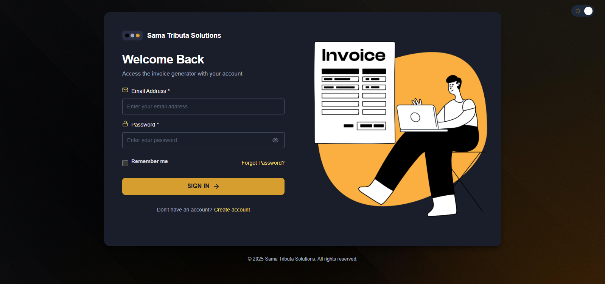
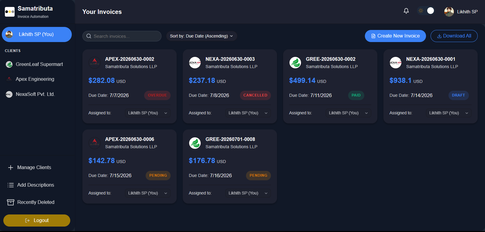
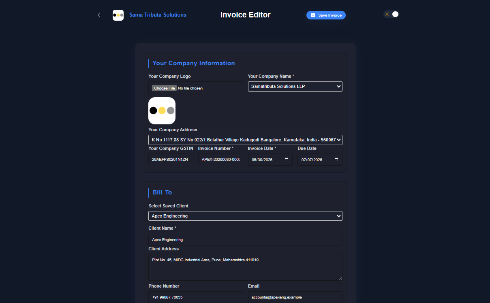
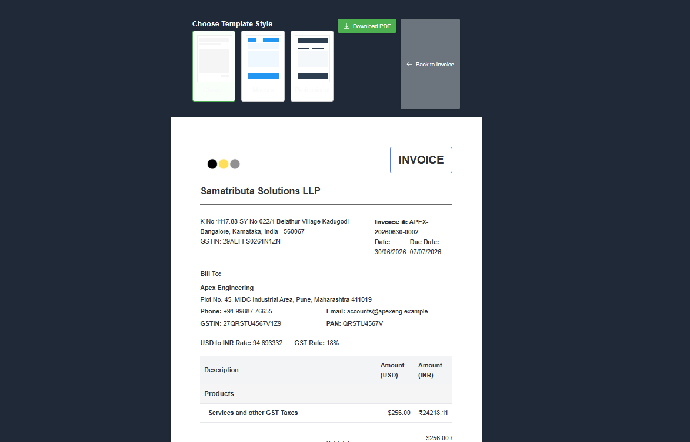

# Corporate Invoice Application (CIA)
<p align="center">
  
  
  
  
  <b>A professional enterprise-grade invoice management system with dual currency support (USD and INR),dashboard,manage and edit invoices  built with React and Vite</b><br><a href="https://journifyx.vercel.app" target="_blank">Visit Now</a> <br>

</p>

## Overview

CIA is a comprehensive invoice generator designed for businesses that operate across USD and INR currencies. It provides a complete solution for creating, managing, and tracking invoices with a modern, responsive UI and powerful features like PDF generation, email capabilities, and real-time currency conversion.

## Key Features

### Core Functionality
- **Invoice Creation**: Generate professional invoices with customizable templates
- **Multi-Currency Support**: Native USD and INR support with automatic conversions
- **Real-time Exchange Rates**: Integration with exchange rate APIs
- **Tax Calculation**: Automatic GST/tax calculations with configurable rates
- **PDF Generation**: Export invoices as professional PDF documents
- **Email Integration**: Send invoices directly to clients via email

### User Experience
- **Modern UI**: Clean, intuitive interface with responsive design
- **Dark Mode**: Full dark theme support for comfortable viewing
- **Dashboard**: Visual overview of invoice status and financial metrics
- **Client Management**: Store and manage client information
- **Company Profiles**: Support for multiple business profiles/entities
- **User Profiles**: Personalized user accounts with avatars and information

### Technical Features
- **Persistent Storage**: Local storage implementation for offline capability
- **Form Validation**: Comprehensive input validation
- **Error Handling**: Global error management with user-friendly notifications
- **Session Management**: Authentication system with timeout handling
- **Responsive Design**: Mobile-friendly interface that works on all devices
- **Modular Architecture**: Component-based design for maintainability

## Installation and Setup

### Prerequisites
- Node.js (v14.0.0 or higher)
- npm or yarn

### Installation Steps

1. **Clone the repository**
   ```bash
   git clone https://github.com/yourusername/CIA.git
   cd CIA
   ```
   

2. **Install dependencies**
   ```bash
   npm install
   # or
   yarn install
   ```

3. **Configure environment variables**
   Create a `.env` file in the root directory based on `.env.example`:
   ```
   VITE_EMAILJS_PUBLIC_KEY=your_emailjs_public_key
   VITE_EMAILJS_SERVICE_ID=your_emailjs_service_id
   VITE_EMAILJS_TEMPLATE_ID=your_emailjs_template_id
   VITE_EXCHANGE_RATE_API_KEY=your_exchange_rate_api_key
   ```

4. **Start development server**
   ```bash
   npm run dev
   # or
   yarn dev
   ```
   Access the application at `http://localhost:5173`

5. **Build for production**
   ```bash
   npm run build
   # or
   yarn build
   ```

6. **Serve production build**
   ```bash
   npm start
   # or
   yarn start
   ```

## User Guide

### Authentication
- Register with name, email, phone number, and job title
- Login with email
- User profile management with avatar customization

### Creating Invoices
1. Navigate to the Dashboard and click "New Invoice"
2. Select your company profile or create a new one
3. Enter client details (or select from saved clients)
4. Add invoice items with descriptions and amounts
5. Set tax rate and apply exchange rate
6. Preview, save as draft, or finalize the invoice

### Managing Invoices
- View all invoices from the Dashboard
- Filter by status (Draft, Pending, Paid, Cancelled)
- View detailed invoice information
- Download invoices as PDF
- Send invoices via email to clients

### Company Management
- Create multiple company profiles
- Customize with logo, address, and banking details
- Set company as default for new invoices

### User Settings
- Update personal information
- Change avatar
- Toggle dark/light mode
- View account activity

## Architecture and Technical Documentation

### Technology Stack
- **Frontend Framework**: React 18
- **Build Tool**: Vite
- **Styling**: CSS with custom variables for theming
- **PDF Generation**: jsPDF with html2canvas
- **Email Service**: EmailJS
- **State Management**: React Context API
- **Form Handling**: Custom hooks with validation
- **Storage**: Browser LocalStorage with fallbacks

### Project Structure
```
/
├── public/                # Static assets
│   ├── images/            # Public images
│   └── favicon.ico        # Site favicon
├── src/
│   ├── assets/            # Imported assets processed by build
│   │   └── logoData.js    # Base64 encoded logos and images
│   ├── components/        # Reusable UI components
│   │   ├── InvoiceForm.jsx       # Main invoice creation form
│   │   ├── InvoiceItemsTable.jsx # Invoice line items management
│   │   ├── InvoicePreview.jsx    # Invoice preview component
│   │   ├── ErrorDisplay.jsx      # Error notification system
│   │   └── Modal.jsx             # Reusable modal dialog
│   ├── config/            # Application configuration
│   ├── constants/         # Application constants and enums
│   ├── context/           # React Context providers
│   │   ├── ErrorContext.jsx      # Global error handling
│   │   └── NotificationContext.jsx # Notification system
│   ├── hooks/             # Custom React hooks
│   │   ├── useAuth.js     # Authentication logic
│   │   └── useForm.js     # Form handling utilities
│   ├── lib/               # Business logic
│   │   └── invoiceLogic.js # Invoice calculations and processing
│   ├── pages/             # Page components
│   │   ├── LoginPage.jsx         # Authentication page
│   │   ├── DashboardPage.jsx     # Main dashboard
│   │   ├── InvoicePage.jsx       # Invoice creation/editing
│   │   ├── ProfilePage.jsx       # User profile management
│   │   └── CompanyPage.jsx       # Company settings
│   ├── services/          # External service integrations
│   │   ├── emailService.js       # Email functionality
│   │   ├── exchangeRateService.js # Currency exchange rates
│   │   └── pdfService.js         # PDF generation
│   ├── types/             # Type definitions
│   └── utils/             # Utility functions
│       ├── imageUtils.js         # Image processing utilities
│       ├── storage.js            # LocalStorage wrapper
│       └── validationUtils.js    # Form validation helpers
├── server.js              # Express server for production
└── vite.config.js         # Vite configuration
```

### Core Components

#### InvoiceForm Component
The central form for creating and editing invoices with the following features:
- Multi-section UI with company, client, and service details
- Dynamic service item addition with nested sub-services
- Real-time calculations for tax and currency conversion
- Bank detail management and notes
- Form validation and error handling

#### InvoiceItemsTable Component
Manages the line items in an invoice with:
- Main service and sub-service hierarchy
- Dynamic addition and removal of items
- Real-time amount calculations in both currencies
- Input validation for numeric fields

#### InvoicePreview Component
Renders a professional invoice preview with:
- A4 layout for PDF generation
- Structured sections for company, client, and service details
- Tax and total calculations display
- Bank details and payment instructions

### State Management
The application uses React Context for global state management:
- **ErrorContext**: Manages global error handling and display
- **NotificationContext**: Provides a system for user notifications
- **Component State**: Local state for UI components using React hooks

### Data Flow
1. User inputs flow through controlled components
2. Data is validated using validation utilities
3. Business logic is applied (calculations, formatting)
4. State is updated in the appropriate scope
5. UI renders reflect the current state
6. Data is persisted to localStorage for offline capability

### Authentication System
A simplified authentication system with:
- User registration storing name, email, phone, and job title
- Basic login/logout functionality
- Profile management with avatar customization
- Session timeout handling for security

### Responsive Design
The application is fully responsive with:
- Mobile-first approach with flexible layouts
- CSS variables for theming and consistent styling
- Dark mode support across all components
- Print-optimized styles for PDF generation

## Deployment Options

### Netlify Deployment
The repository includes a `netlify.toml` configuration for easy deployment:
```bash
# Just connect your GitHub repository to Netlify
# Netlify will automatically detect the configuration
```

### Render Deployment
A `render.yaml` configuration is included for deployment on Render:
```bash
# Set up a new Web Service on Render pointing to your repository
# Render will use the configuration in render.yaml
```

### Manual Deployment
For custom hosting:
1. Build the project: `npm run build`
2. Deploy the `dist` directory to your web server
3. For SPAs, ensure proper URL rewriting (included in `public/redirect.js`)

## Troubleshooting

The application includes diagnostic tools for troubleshooting:
- `/debug` route - Basic system and JavaScript tests
- `/diagnostic` route - Storage and library test utilities
- `/demo` route - Feature demonstration

Common issues:
- **PDF Generation Issues**: Check browser console for canvas security errors
- **Email Sending Failures**: Verify EmailJS credentials in environment variables
- **Currency Conversion Problems**: Check exchange rate API key and network connectivity
- **Storage Errors**: Ensure localStorage is enabled in your browser

## Contributing

1. Fork the repository
2. Create a feature branch (`git checkout -b feature/amazing-feature`)
3. Commit your changes (`git commit -m 'Add some amazing feature'`)
4. Push to the branch (`git push origin feature/amazing-feature`)
5. Open a Pull Request

## Recent Feature Enhancements (2026 Updates)

### 1. Advanced Invoice Calculations & Fields
- **Dual Amount Paid & Balance Due Inputs**: Enter payment details in either USD or INR; the system auto-converts based on the exchange rate and updates the **Grand Total (Balance Due)**.
- **Auto-Calculations**: Dynamic calculations of subtotal, tax amount, amount paid, and balance due values.
- **Custom Bank Fields**: Includes random account number, IFSC code, and customizable **UPI ID** fields.
- **Signatures**: Digital signatures supported directly on invoice forms using name input.
- **Due Date Tracking**: Automatically marks invoices as **Overdue** if they remain in a pending state past their due date.

### 2. Premium Invoice Templates
- **Redesigned Modern Template**: Fully overhauled minimalist template utilizing gradient blue banners, modern Poppins typography, rounded shadow card layouts, signature flows, UPI visibility, and high-contrast light labels for readability.
- **Unified Exchange Rate Flow**: Template previews utilize the precise, custom exchange rate defined on the invoice during creation.

### 3. Dashboard Improvements
- **Default Sort Settings**: Invoices are now sorted by **Due Date** in **Ascending** order by default when the dashboard is loaded.
- **New Sort Options**: Sort invoices by Client Name or Due Date.
- **Status Sort Priority**: Dashboard sorting prioritizes status in the order of `Draft`, `Pending`, `Paid`, and `Cancelled`.
- **Card Updates**: Dashboard invoice cards display **Due Date** instead of creation date with optimized column spacing so dates never wrap.
- **Interactive Status Filters**: Filter dashboard cards by clicking on specific status categories.

### 4. Usability & Mock flows
- **Description Autocompletes**: Auto-populated service descriptions with 19 common tax returns (e.g. US Federal Form 1120, 1065, 1040) and accounting advisory options.
- **Inline Send Mockup**: Simulated Send Invoice flow shows sending progress and a green success block directly inside the Send modal box without page redirection.

## License

This project is licensed under the MIT License - see the LICENSE file for details.

---

© 2026 Sama Tributa Solutions | Created with ❤️ by Your Company


